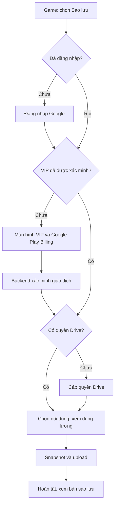

# Kế hoạch cho Gemini (Antigravity): Tìm kiếm Game, đăng nhập Google, VIP và sao lưu Google Drive

Ngày nghiên cứu: **02/10/2026**. Dự án: `F:\AI\T-Emulator`, ứng dụng Android `com.temulator.app`.

**Trạng thái: chỉ lập kế hoạch. Chưa triển khai tính năng, chưa cấu hình dịch vụ bên ngoài, chưa kiểm thử bản build mới.** Tài liệu này là đầu vào để Gemini/Antigravity thực hiện trong lượt làm việc tiếp theo.

## 1. Mục tiêu và các giả định sản phẩm

1. Thêm tìm kiếm ngay trong tab **Game** để tìm game đã quét; tiếp tục hỗ trợ những game được thêm thủ công vào cùng thư viện.
2. Thêm **Đăng nhập bằng Google**, có khu vực tài khoản trong tab **Thêm/More** và điểm vào từ tab Game.
3. Thêm luồng **VIP** để mở khóa sao lưu game lên **Google Drive của chính người dùng**, cùng khả năng khôi phục.

Giả định để triển khai nếu chủ dự án chưa chọn phương án khác:

| Quyết định | Phương án đề xuất |
| --- | --- |
| Phạm vi sao lưu | ROM gốc + thông tin game + dữ liệu lưu tiến trình hiện có; có lựa chọn chỉ sao lưu dữ liệu lưu |
| Hình thức VIP | Thuê bao hàng năm (20.000 đồng/năm), Google Play Billing |
| Dung lượng cloud | Sử dụng dung lượng Drive của người dùng; VIP không cấp thêm dung lượng Drive |
| Thư mục cloud | `T-Emulator Backups`, hiển thị trong My Drive, do ứng dụng tạo |
| Bản đầu | Sao lưu thủ công một game hoặc nhiều game được chọn, quản lý bản sao lưu và khôi phục |
| Giai đoạn sau | Tự động sao lưu sau khi thoát game, lịch sao lưu, giữ nhiều phiên bản, bộ lọc console/nguồn |
| Khi VIP bị thu hồi | Dừng tạo bản sao lưu mới; vẫn cho truy cập, tải và khôi phục bản đã có |

Giá VIP chính thức là **20.000 đồng/năm**, với mô tả: *"Mở khóa VIP chỉ thêm tính năng sao lưu game trên đám mây, các chức năng cốt lõi vẫn giữ nguyên"*. Mã sản phẩm đề xuất: `vip_yearly` (tương thích `vip_lifetime`).

## 2. Hiện trạng mã nguồn đã kiểm tra

Các đường dẫn dưới đây tương đối với thư mục gốc dự án, để Gemini dùng trực tiếp khi triển khai.

| Thành phần | Hiện trạng | Hệ quả cho kế hoạch |
| --- | --- | --- |
| `AndroidApp/app/src/main/java/com/temulator/app/GameRepository.kt` | `GameEntry` có path/URI, tên file, console, thời gian thêm, nguồn; thư viện lưu JSON trong SharedPreferences | Chưa có ID game, checksum hoặc trạng thái backup bền vững |
| `GameRepository.kt`, `getAllGames()` dòng 66 | Đọc JSON và sắp xếp mỗi lần gọi | Không gọi lại trên từng ký tự tìm kiếm |
| `GameRepository.kt`, dòng 93 và 102 | Xóa mục cũ nếu trùng đường dẫn **hoặc tên file** | Hai ROM khác nhau cùng tên có thể bị gộp; cần sửa trước backup |
| `GamesFragment.kt`, dòng 109 và 130 | Quét bằng `Thread`; dựng lại toàn bộ card khi refresh | Cần state theo lifecycle và danh sách tái sử dụng view |
| `res/layout/fragment_games.xml` | `ScrollView` + `LinearLayout`, nút chọn thư mục/quét lại, trạng thái thư viện rỗng | Chưa có tìm kiếm, số kết quả hoặc giao diện backup |
| `MainActivity.kt`, `switchFragment()` dòng 62 | Thay Fragment mỗi lần đổi tab | Query cần state dùng chung hoặc được khôi phục rõ ràng |
| `GamesFragment.kt`, dòng 237/259; `HomeFragment.kt` | Game quét giữ SAF URI; khi mở mới copy vào `filesDir/<fileName>`; game nhập thủ công cũng copy theo tên | Không thể backup thư viện chỉ bằng cách nén `filesDir`; có nguy cơ đè ROM cùng tên |
| `EmulatorActivity.kt`, dòng 90/1266 | Native home là `filesDir`; khi pause flush battery save | Snapshot phải lấy dữ liệu sau flush và phối hợp với vòng đời emulator |
| `Utilities/FolderUtilities.cpp` | Thư mục save mặc định là `Saves` và `SaveStates` | Cần ánh xạ dữ liệu theo từng game |
| `Core/Shared/SaveStateManager.cpp`; `BatteryManager.cpp` | Save dựa vào tên ROM native; state dạng `<basename>_<slot>.mss` | Cùng basename có thể đụng save; tên ROM bên trong ZIP có thể khác tên ZIP |
| `Core/Shared/CdReader.cpp` | CUE tham chiếu track qua đường dẫn tương đối | Sao lưu riêng file `.cue` sẽ thiếu dữ liệu game |
| `MoreFragment.kt`; `res/layout/fragment_more.xml` | Chỉ có ngôn ngữ, cập nhật, giới thiệu | Thêm khu vực tài khoản, VIP và Drive ở đây |
| Gradle và Manifest | Kotlin/XML Views, minSdk 26, compile/target SDK 36; AGP 8.1.1, Gradle 8.3, Kotlin 1.9.0; chưa có auth/billing/Drive hay quyền Internet | Cần kiểm tra bộ phiên bản trước khi thêm SDK |
| `PRIVACY_POLICY_vi.md`; `values*/strings.xml` | Hiện công bố không có tài khoản, không truyền dữ liệu ngoài thiết bị | Phải cập nhật nội dung cùng với tính năng cloud |

Chưa thấy backend và bộ test riêng cho các luồng này. Bản kế hoạch không kết luận bản build hiện tại đã đạt kiểm thử. Workspace hiện không có Git checkout ở thư mục gốc; Gemini cần kiểm tra lại trước khi lập branch/commit.

## 3. Luồng giao diện

### 3.1. Tìm kiếm trong tab Game

- Đặt ô **Tìm game đã quét hoặc đã thêm…** dưới tiêu đề và nhóm nút chọn thư mục/quét lại.
- Tìm theo tên hiển thị và tên file, gồm cả phần mở rộng. Chuẩn hóa trim, chữ hoa/thường bằng `Locale.ROOT`; hỗ trợ tìm không dấu tiếng Việt, gồm ánh xạ `đ → d`.
- Query rỗng trả toàn bộ thư viện theo thứ tự thêm mới nhất hiện có. Tìm kiếm chỉ lọc thư viện cục bộ, không khởi chạy một lần quét mới.
- Có nút xóa query và số kết quả, ví dụ `8 / 120 game`. Phân biệt **Chưa có game** với **Không tìm thấy game phù hợp**.
- Giữ query khi xoay màn hình, đổi tab, quay lại sau khi chơi và khôi phục process nếu hệ thống cung cấp saved state. Quét/thêm/xóa trong lúc đang tìm phải cập nhật kết quả mà không xóa query.
- Dùng `RecyclerView` + `ListAdapter/DiffUtil`; cache danh sách và chuỗi tìm đã chuẩn hóa. Debounce đề xuất 200 ms, `distinctUntilChanged`, không đọc JSON/SAF hoặc hash ROM trên mỗi ký tự.
- `GamesViewModel` sở hữu query, danh sách, trạng thái quét và trạng thái chọn nhiều game. Vì MainActivity tạo Fragment mới, dùng ViewModel phạm vi Activity với `SavedStateHandle`, hoặc một cơ chế giữ state tương đương đã kiểm thử.
- Thu thập state bằng `viewLifecycleOwner.repeatOnLifecycle`; không cập nhật view đã bị hủy. Giữ giao diện XML/ViewBinding hiện có.

Tham chiếu triển khai: [ListAdapter](https://developer.android.com/reference/androidx/recyclerview/widget/ListAdapter), [kiến trúc Android Views](https://developer.android.com/topic/architecture/views/recommendations-views).

### 3.2. Tài khoản và VIP

Trong **Thêm/More**, thêm card tài khoản gồm avatar/tên/email, trạng thái VIP, nút đăng nhập/đăng xuất, mục Google Drive, khôi phục giao dịch mua và xóa tài khoản ứng dụng. Tab Game có nút **Sao lưu Google Drive · VIP** và mục **Bản sao lưu**.

| Trạng thái người dùng | Khi bấm tạo bản sao lưu |
| --- | --- |
| Chưa đăng nhập | Hiển thị lợi ích và nút đăng nhập Google; cho hủy để tiếp tục dùng thư viện |
| Đã đăng nhập, chưa có VIP | Mở màn hình VIP; có giá từ Play và nút khôi phục giao dịch mua |
| Giao dịch đang chờ xác nhận | Hiển thị trạng thái đang xử lý; chưa mở khóa upload |
| Đã có VIP, chưa cấp quyền Drive | Giải thích đích lưu và mở luồng cấp quyền Drive |
| VIP + quyền Drive hợp lệ | Chọn game, thành phần backup, xem dung lượng, xác nhận rồi tạo job |
| Thiếu mạng/quyền Drive bị thu hồi | Hiển thị việc cần làm; lưu lựa chọn và cho thử lại |
| VIP bị thu hồi | Giới thiệu mở khóa lại; bản backup đã có vẫn được khôi phục |

Ghi nhớ hành động ban đầu sau login/paywall/consent để quay lại đúng game hoặc tập game đã chọn. Không tự upload ngay sau đăng nhập hay sau thanh toán; luôn trở về bước xem nội dung sao lưu.



Luồng khôi phục chỉ cần đăng nhập và quyền Drive đúng tài khoản, có thể sử dụng với VIP đã bị thu hồi. Tìm kiếm/quét/chơi/lưu cục bộ luôn hoạt động offline và không yêu cầu tài khoản.

## 4. Kiến trúc đăng nhập và xác minh VIP

### 4.1. Đăng nhập Google

Đề xuất **Credential Manager → Google ID token → Firebase Authentication**. Android lấy phiên Firebase; backend xác minh **Firebase ID token** trước khi truy cập hồ sơ hoặc quyền VIP. Dùng Firebase UID làm khóa tài khoản ứng dụng, không dùng email làm ID. [Google Sign-in qua Credential Manager](https://developer.android.com/identity/sign-in/credential-manager-siwg), [Firebase Google Authentication](https://firebase.google.com/docs/auth/android/google-signin), [xác minh Firebase ID token](https://firebase.google.com/docs/auth/admin/verify-id-tokens).

- Có nút Google theo hướng dẫn thương hiệu; xử lý người dùng hủy, không có credential, thiết bị thiếu Google Play services và mạng lỗi.
- Yêu cầu ID token với Web client ID đúng dự án. SDK quản lý phiên/refresh; không lưu token trong JSON thư viện, log hoặc gói sao lưu.
- Đăng xuất: sign out Firebase, clear credential state, xóa cache tài khoản/cloud và dừng job gắn với phiên cũ; giữ nguyên thư viện và save cục bộ.
- **Ngắt kết nối Drive** là hành động riêng với đăng xuất. **Xóa tài khoản ứng dụng** là hành động riêng với xóa tài khoản Google.
- Đăng nhập và cấp quyền Drive là hai bước. Chỉ dùng `AuthorizationClient` xin scope Drive khi người dùng thực hiện backup/restore. [Android authorization](https://developer.android.com/identity/authorization).

### 4.2. VIP mua một lần

Đề xuất một non-consumable product, ID minh họa `vip_lifetime`. Màn hình VIP nêu chính xác tính năng mở khóa và việc dùng dung lượng Drive cá nhân. Giá/tiền tệ/ưu đãi lấy từ `ProductDetails` hiện hành, không hardcode.

1. Yêu cầu đăng nhập ứng dụng trước khi mua. Backend cấp một định danh che giấu gắn với UID; truyền vào `obfuscatedAccountId` của Billing.
2. Billing trả `purchaseToken`; gửi token tới backend bằng phiên Firebase đã xác minh. Pending/canceled không cấp VIP.
3. Backend gọi `purchases.productsv2.getproductpurchasev2`, kiểm tra package, product line item, trạng thái `PURCHASED`, định danh tài khoản và token chưa thuộc UID khác.
4. Lưu giao dịch/quyền VIP theo transaction idempotent; cấp entitlement rồi acknowledge. VIP không tiêu hao nên **không consume**.
5. Chỉ hiển thị đã mở khóa sau phản hồi entitlement của backend. Đồng bộ khi mở app, mua xong và bấm khôi phục giao dịch mua.

Nguồn: [tích hợp Billing](https://developer.android.com/google/play/billing/integrate), [ProductPurchaseV2](https://developers.google.com/android-publisher/api-ref/rest/v3/purchases.productsv2/getproductpurchasev2), [bảo vệ quyền mua](https://developer.android.com/google/play/billing/security). Acknowledge phải được hoàn thành trong thời hạn của Play; hiện tài liệu quy định ba ngày từ khi giao dịch chuyển thành PURCHASED. Backend cần retry và theo dõi giao dịch chưa acknowledge.

- Firebase UID ứng dụng, tài khoản Google Play thanh toán và tài khoản Drive là các khái niệm riêng. Không suy ra người mua Play từ email đăng nhập.
- Một token chỉ liên kết với một UID. Restore trên cùng UID khôi phục VIP; đổi UID không tự chuyển VIP. Giao dịch thiếu định danh cần quy trình phục hồi có xác minh, không tự gán tùy tiện.
- RTDN nhận cả sự kiện one-time product và voided purchase. Dùng sự kiện làm tín hiệu rồi truy vấn Play để xác định trạng thái hiện tại; xác minh nguồn thông báo, xử lý lặp và lệch thứ tự.
- Có job đối soát hoàn tiền/thu hồi bằng Voided Purchases API với watermark và phân trang. Không dựa vào client refresh để phát hiện tất cả refund. [RTDN](https://developer.android.com/google/play/billing/rtdn-reference), [Voided Purchases](https://developers.google.com/android-publisher/api-ref/rest/v3/purchases.voidedpurchases/list).
- Backend là nguồn xác định VIP; cờ SharedPreferences chỉ được dùng làm cache hiển thị. Kiểm tra entitlement ở lúc tạo và bắt đầu upload; nếu backend chưa xác minh được, giữ tác vụ chờ, vẫn cho chơi/tìm kiếm cục bộ.

### 4.3. Backend tối thiểu

Đề xuất Firebase Authentication + Cloud Functions/Cloud Run + Firestore; lựa chọn này cần cấu hình dự án, quyền Play API và kiểm tra chi phí trước triển khai thật. ROM/save truyền trực tiếp giữa Android và Drive; backend chỉ xử lý tài khoản, giao dịch và entitlement.

| API hoặc thành phần | Nhiệm vụ |
| --- | --- |
| `GET /v1/me` | Trả UID và hồ sơ tối thiểu |
| `GET /v1/entitlements` | Trả trạng thái VIP, nguồn quyền, thời điểm xác minh |
| `POST /v1/purchases/verify` | Xác minh token và cấp quyền theo giao dịch idempotent |
| `POST /v1/purchases/restore` | Đối soát các giao dịch client truy vấn được với UID hiện tại |
| `DELETE /v1/account` | Xóa tài khoản/dữ liệu liên quan theo chính sách được công bố |
| Consumer RTDN + reconciliation job | Acknowledge retry, cập nhật quyền bị thu hồi, đối soát refund |

Mọi endpoint cần auth và authorization theo UID; client không được ghi entitlement trong Firestore. Lưu token giao dịch an toàn phía server, tạo unique index/khóa hash để chống claim trùng. Không đưa service-account key hoặc OAuth client secret vào APK. App Check có thể bổ sung bảo vệ abuse, không thay thế việc kiểm tra giao dịch.

## 5. Nền tảng dữ liệu và dữ liệu lưu theo game

Giải quyết trước Google Drive để tránh sao lưu nhầm game hoặc nhầm tiến trình:

1. Thêm `gameId` UUID bền vững, giữ nguyên khi quét lại cùng source URI/path. Không dedup bằng tên file. Tính `contentSha256` trên IO thread khi cần; tách ID thư viện khỏi checksum nội dung. Với CUE nhiều file, fingerprint nội dung phải bao gồm descriptor và checksum toàn bộ asset theo thứ tự đường dẫn xác định, không chỉ hash descriptor; archive ghi thêm selected member và console.
2. Chuyển thư viện sang Room khi thêm dữ liệu backup/job; giữ API repository để phần tìm kiếm không phụ thuộc cơ chế lưu. Migration từ `game_library/games_json` và `scan_folder_uri` phải có backup cục bộ, chạy một lần, xác nhận đủ dữ liệu trước khi bỏ dữ liệu cũ. Những mục đã bị gộp trước đây cần quét lại; migration không thể tự khôi phục mục không còn trong JSON.
3. Copy ROM an toàn vào `filesDir/games/<gameId>/rom/<sanitizedOriginalName>`, bằng stream vào file tạm rồi rename sau khi ghi thành công. Nếu `openInputStream()` trả null phải báo thất bại, không tạo đường dẫn giả thành công.
4. Truyền `GAME_ID` qua Intent và ghi mapping với console native thực tế, basename native và selected archive member. Với ZIP/7z, không suy ra tên save từ tên archive ngoài. Với CUE, lưu danh sách descriptor/track/sub cùng đường dẫn tương đối và quyền nguồn; nếu chọn file đơn không đủ quyền đọc file phụ thuộc, hướng dẫn chọn thư mục bằng SAF rồi resolve lại.
5. Tạo `filesDir/games/<gameId>/Saves` và `SaveStates`. Thêm bridge cấu hình folder override trước khi load ROM; giữ home/firmware chung. Cả Home và Game dùng cùng dịch vụ nhập/mở game để bảo đảm nhất quán.
6. Migrate save cũ theo mapping duy nhất đã xác minh. Nếu nhiều game có cùng basename, yêu cầu người dùng chọn mapping; giữ bản cũ và rollback. Không copy một save chưa xác định cho mọi game cùng tên.

Model tối thiểu đề xuất:

| Model | Trường chính |
| --- | --- |
| `GameRecord` | gameId, sourceUri/localPath, sourceTreeUri nullable, displayName, originalFileName, consoleType, addedAt, source, contentSha256 nullable |
| `GameAsset` | gameId, role (ROM/descriptor/track/sub), relativePath, sourceUri/localPath, size, checksum nullable; resolver bảo toàn cây tương đối của CUE |
| `NativeGameMapping` | gameId, nativeBasename, nativeConsole, archiveMember nullable, saveDirectory, stateDirectory |
| `CloudBackupRecord` | ownerUid, Drive account identity, gameId, backupId, remoteFileId, schemaVersion, createdAt, checksum, size, status |
| `TransferRecord` | jobId, batchId nullable, ownerUid, accountSessionVersion, backupId, operation, stage, progress, resumableSession, retry/error metadata |

Backup manifest dùng đường dẫn tương đối và phiên bản schema; không mang URI SAF cũ sang thiết bị mới như một quyền truy cập hợp lệ. Query tìm kiếm giữ trong saved state; quyền VIP lưu server, không migrate thành dữ liệu thư viện.

## 6. Sao lưu và khôi phục Google Drive

### 6.1. Quyền và tài khoản Drive

Đề xuất scope **`https://www.googleapis.com/auth/drive.file`** cho folder/file do ứng dụng tạo. Scope này phù hợp việc quản lý bản backup của ứng dụng. Nếu chọn backup ẩn, có thể dùng `appDataFolder` với `drive.appdata`; cần đổi UX quản lý file tương ứng. [Drive scopes](https://developers.google.com/workspace/drive/api/guides/api-specific-auth), [app data folder](https://developers.google.com/workspace/drive/api/guides/appdata).

- Pin account được authorize về đúng Google account đã đăng nhập; xử lý account mismatch bằng chọn/đăng nhập lại rõ ràng. Namespace local cache và job bằng UID + Drive account, không dùng folder ID chung cho mọi người.
- Tách authorize/token provider khỏi transport Drive REST v3. Lấy access token qua SDK khi cần; worker thiếu khả năng cấp quyền phải chuyển sang `NEEDS_AUTH`, chỉ mở consent từ giao diện foreground.
- Đổi tài khoản/đăng xuất tăng `accountSessionVersion`, hủy job cũ và kiểm lại UID/account/version trước mỗi request hoặc commit. Không chuyển token/session upload của A sang B.
- Dùng app properties để nhận diện folder/backup theo schema, backupId và gameId; không chỉ tìm theo tên. Quản lý file ID nếu người dùng đổi tên/move/trash folder. Hỗ trợ phân trang và khám phá lại trên cài đặt mới cùng tài khoản/OAuth project.
- Liệt kê và restore không phụ thuộc index trên backend; mất cache local hoặc gỡ/cài lại vẫn tìm được bản backup trên Drive.

### 6.2. Gói sao lưu

Mỗi game có một snapshot độc lập gồm manifest và payload của chính game đó, đóng thành một bundle ZIP; ZIP/7z ROM gốc nằm nguyên trong bundle. Sao lưu nhiều game tạo một batch chứa các bundle/job riêng, hiển thị tiến trình tổng và kết quả từng game. Một game thất bại không làm các game đã hoàn tất bị đánh dấu thất bại hoặc bị xóa.

Manifest tối thiểu gồm schemaVersion, backupId, gameId, tên gốc, console, checksum ROM, selected archive member, app/native/state-format version, thời điểm snapshot và danh sách file với loại/kích thước/checksum/đường dẫn tương đối.

- Game quét chưa từng chơi: đọc ROM từ SAF gốc; quyền bị mất thì yêu cầu chọn lại, không bỏ qua âm thầm.
- Dữ liệu lưu: lấy battery/SRAM, RTC, state các slot và phụ trợ thuộc game theo mapping. Không chỉ tìm `.sav`; native hiện có nhiều loại save khác nhau.
- ZIP/7z: lưu nguyên archive và metadata của ROM được chọn trong archive.
- CUE rời: đóng gói descriptor cùng toàn bộ track/sub file phụ thuộc, giữ đường dẫn tương đối an toàn. Thiếu quyền/track phải báo đúng game chưa sao lưu đầy đủ. Đây là tiêu chí hoàn tất hỗ trợ CUE, không được báo thành công khi chỉ upload descriptor.
- Không đóng gói toàn bộ `filesDir`, tài khoản/token, entitlement, firmware hoặc file game khác. Tên file từ SAF/manifest phải được sanitize và kiểm tra đường dẫn.

Tạo snapshot sau khi emulator flush/pause/stop, rồi sao chép vào staging cố định; upload chỉ đọc staging. Không restore khi native còn ghi dữ liệu của game đó. `JniBridge.cpp` hiện trả true sau lời gọi SaveState dạng void; khi triển khai cần xác minh file đã ghi thực sự, không dùng riêng boolean này để công bố snapshot thành công.

### 6.3. Upload, trạng thái và retry

```text
QUEUED → PREPARING → UPLOADING → VERIFYING → COMPLETED
             ↘ NEEDS_AUTH / WAITING_NETWORK / FAILED / CANCELED
```

- Preflight: kiểm tra source, dung lượng staging, kích thước bundle, entitlement và quota Drive nếu khả dụng. Hiển thị thành phần, dung lượng và lựa chọn mạng trước bắt đầu.
- Stream dữ liệu; dùng resumable upload cho bundle lớn hoặc mạng không ổn định, lưu session/offset an toàn. Khi session hết hạn, tạo lại theo cùng backupId để tránh duplicate.
- Chỉ công bố bản hoàn chỉnh khi upload và kiểm tra metadata/checksum kết thúc. Nếu dùng nhiều cloud object, manifest complete phải commit cuối. Bản hoàn chỉnh trước đó luôn được giữ khi retry thất bại.
- Cancel phải dừng request và đánh dấu job; cleanup file chưa hoàn chỉnh do ứng dụng tạo. Có retry backoff cho 429/5xx, xử lý token hết hạn, scope bị thu hồi, quota đầy và source bị mất bằng trạng thái cụ thể.
- Không đặt ngưỡng 5 MB thành giới hạn dung lượng game. Giới hạn bundle/staging/concurrency phải là cấu hình sản phẩm dựa trên đo đạc; 5 MB trong hướng dẫn Drive là ngưỡng lựa chọn cách upload. [Drive upload](https://developers.google.com/workspace/drive/api/guides/manage-uploads), [Drive errors](https://developers.google.com/workspace/drive/api/guides/handle-errors).

Tác vụ ngắn, có thể ngắt/retry dùng WorkManager. Transfer dài do người dùng khởi tạo: thiết kế scheduler dùng UIDT trên API 34+, foreground worker fallback ở bản thấp hơn, notification tiến trình và nút hủy/tiếp tục. Vì target SDK 36, kiểm thử quota/background thực tế; foreground WorkManager không được giả định chạy vô hạn. Khai báo Internet và các permission/service notification/foreground/UIDT đúng nhánh được dùng. [Lựa chọn transfer](https://developer.android.com/develop/background-work/background-tasks/data-transfer-options), [UIDT](https://developer.android.com/develop/background-work/background-tasks/uidt), [long-running workers](https://developer.android.com/develop/background-work/background-tasks/persistent/how-to/long-running).

### 6.4. Khôi phục

1. Trong Game → **Bản sao lưu**, liệt kê các bản hoàn chỉnh thuộc Drive account hiện tại; chọn game/bản/thành phần cần phục hồi.
2. Download vào staging; kiểm tra schema/version, checksum, danh sách file, kích thước và dung lượng trống. [Drive download](https://developers.google.com/workspace/drive/api/guides/manage-downloads).
3. Chặn path traversal, path tuyệt đối, symlink và archive bomb; không ghi bất cứ file nào ngoài staging/đích game được xác định.
4. Hiển thị xung đột local/cloud; cho giữ dữ liệu local hoặc thay thế sau xác nhận. Tạo bản rollback trước khi thay save, không chọn bản mới hơn chỉ dựa đồng hồ thiết bị.
5. Kiểm tra ROM/console/state compatibility. State không tương thích phải báo riêng; có thể phục hồi ROM/SRAM tương thích mà không tự load state lỗi.
6. Với bản có ROM, commit dữ liệu đã xác minh theo giao dịch có journal/rollback, tạo GameRecord với đường dẫn nội bộ mới và nguồn `restore`. Với bản chỉ có save, tìm ROM local khớp checksum và console; nếu chưa có, yêu cầu nhập/chọn ROM và xác minh trước khi commit save. Không tạo mục game có ROM chưa tồn tại hoặc ghi đè game cùng tên nhưng khác checksum.
7. Hoàn tất, refresh thư viện, cho mở game. Có bài test khôi phục trên cài đặt mới; đây là điều kiện nghiệm thu backup.

## 7. Cấu hình ngoài mã nguồn và quyền riêng tư

Các mục này là công việc cần thực hiện khi Gemini triển khai, chưa được thực hiện trong lượt lập kế hoạch:

- Google Cloud/Firebase: dự án, bật Google auth/Drive API, cấu hình Android và Web OAuth clients, consent/branding và test users; kiểm tra fingerprint debug, release và **Play App Signing**. Các môi trường phải cùng cấu hình OAuth phù hợp để backup phục hồi được.
- Play Console: merchant/products, giá và khu vực; internal testing/license testers; cấp quyền Google Play Developer API cho backend; Pub/Sub RTDN gồm one-time products/voided purchases.
- Backend: môi trường riêng, secrets/role tối thiểu, rules Firestore, logging không lộ token/ROM, retry/reconciliation và quy trình account deletion.
- Dependencies: Credential Manager, googleid, Google authorization Play services, Firebase Auth/BOM, Billing, lifecycle/coroutines, RecyclerView, Room và scheduler/HTTP cần thiết. Gemini phải khóa các phiên bản ổn định tương thích, không dùng dynamic `+`.
- SDK 36 yêu cầu AGP tối thiểu 8.9.1 theo bảng Android; hiện dự án dùng 8.1.1. Lập nâng cấp AGP/Gradle/Kotlin/KSP tương thích trong một bước riêng, giữ JDK/NDK/CMake/ABI cấu hình phù hợp và kiểm thử emulator sau nâng cấp. [Bảng tương thích AGP](https://developer.android.com/build/releases/about-agp).
- Manifest đang `allowBackup=true`: quyết định Android Auto Backup rõ ràng, loại token/session/entitlement cache/staging khỏi cloud/device-transfer rules; không xem Auto Backup là quyền VIP Google Drive. [Android Auto Backup](https://developer.android.com/identity/data/autobackup).
- Cập nhật `AndroidApp/PRIVACY_POLICY_vi.md`, nội dung chính sách trong `values`, `values-vi`, `values-en`, chính sách công khai và Play Data safety theo dữ liệu thật: hồ sơ Google, UID, giao dịch, tệp do người dùng chủ động gửi Drive.
- Có đường dẫn xóa tài khoản trong ứng dụng và trang web yêu cầu xóa tài khoản/dữ liệu. Giải thích riêng xóa hồ sơ ứng dụng, giữ/xóa bản Drive và dữ liệu cục bộ. Nếu người dùng chọn xóa backup, hoàn thành trước khi revoke quyền Drive; nếu đã mất quyền phải cung cấp cách tự xóa trên Drive và kết quả thực tế. [Account deletion của Google Play](https://support.google.com/googleplay/android-developer/answer/13327111?hl=en).
- Chốt quy trình sau account deletion rồi đăng nhập lại/restore giao dịch; dữ liệu chống gian lận cần giữ nếu có phải được mô tả và giới hạn. Không vô tình cấp một token mua cho nhiều tài khoản hoặc làm mất quyền đã mua mà không có đường phục hồi.

## 8. Thứ tự triển khai và file dự kiến

| Bước | Công việc | Kết quả cần bàn giao |
| --- | --- | --- |
| P0 — Chuẩn bị | Xác nhận quyết định sản phẩm; baseline build/test; phiên bản dependency/toolchain; hợp đồng auth/billing/cloud; console checklist | Thiết kế đã chốt, cấu hình môi trường và baseline có bằng chứng |
| P1 — Tìm kiếm | ViewModel/state, RecyclerView, tìm kiếm/empty/count, giữ query, sửa cập nhật view khi scan | Tìm kiếm hoạt động độc lập, offline, không cần backend |
| P2 — Dữ liệu game | Stable ID, migration Room, chống trùng tên, lưu ROM/save theo game, mapping archive/CUE, snapshot staging | Snapshot local + restore local đúng trước khi kết nối Drive |
| P3 — Google account | Credential Manager/Firebase, account UI, logout/switch/delete, backend auth | Đăng nhập thật trên debug và bản ký dành cho internal testing |
| P4 — VIP | Billing, backend verify/acknowledge/restore, RTDN/refund, paywall | VIP chỉ mở theo giao dịch đã xác minh; dữ liệu local không bị ảnh hưởng |
| P5 — Drive | Authorization, folder/index discovery, backup/batch, scheduler/progress/retry, restore/conflict | Round-trip trên thiết bị/cài đặt mới, đúng account và checksum |
| P6 — Hoàn thiện | VI/EN, privacy/Data safety, release R8/JNI, kiểm thử lỗi và hướng dẫn cấu hình | Báo cáo nghiệm thu, internal-test build và danh sách việc phát hành còn lại |

Auth/backend và snapshot local có thể thực hiện song song sau P0; tích hợp Drive chỉ sau khi định danh game và ràng buộc tài khoản/quyền đã rõ. Không làm lại toàn bộ UI hoặc core emulator để thêm ba tính năng này.

File sửa chính:

- `AndroidApp/build.gradle.kts`, `gradle/wrapper/gradle-wrapper.properties`, `app/build.gradle.kts`, `app/proguard-rules.pro`, `app/src/main/AndroidManifest.xml`.
- `app/src/main/java/com/temulator/app/{GamesFragment,GameRepository,MainActivity,HomeFragment,MoreFragment,EmulatorActivity,EmulatorNative}.kt`.
- `app/src/main/cpp/JniBridge.cpp` cho folder override/mapping/snapshot nếu cần; hạn chế sửa shared native core, kiểm tra desktop nếu có sửa shared code.
- `app/src/main/res/layout/{fragment_games,fragment_more}.xml`, thêm item/list/dialog cần thiết; `values*/strings.xml`, thêm cấu hình backup rules.
- `AndroidApp/PRIVACY_POLICY_vi.md` và tài liệu cấu hình/kiểm thử.

File/thành phần mới dự kiến, có thể điều chỉnh tên nhưng giữ ranh giới trách nhiệm:

- `GamesViewModel`, `GameListAdapter`, `GameSearchNormalizer`, Room entities/DAOs/database/migration.
- `GameStorageManager`, `GameSnapshotService`, `GameRestoreService`, `NativeSaveMapper`.
- `AuthRepository`, `AccountViewModel`, `BillingRepository`, `EntitlementRepository`, màn hình VIP/account.
- `DriveAuthorizationManager`, `DriveBackupRepository`, `TransferScheduler`, worker/UIDT service, màn hình quản lý backup.
- Backend có thư mục riêng, API/rules/tests/config mẫu; Android chỉ có cấu hình public cần thiết, server secrets ở secret manager.

## 9. Tiêu chí nghiệm thu và bộ tình huống kiểm thử

| Nhóm | Tình huống bắt buộc |
| --- | --- |
| Search | Một phần tên, hoa/thường, khoảng trắng, không dấu, đuôi file, query rỗng; empty-library khác no-results; xóa query; scan/add/delete trong khi lọc |
| Lifecycle | Xoay màn hình, đổi tab, trở về từ emulator, hủy view khi scan, process recreation; query và job state đúng |
| Hiệu năng | Thư viện 5.000–10.000 mục; đo trên thiết bị được ghi rõ; mục tiêu kết quả trong 300 ms gồm debounce khi nhập, không ANR hay dựng lại toàn bộ card |
| Migration | JSON cũ, dữ liệu thiếu field, migration gián đoạn/retry; rescan không đổi gameId; hai game khác nội dung cùng tên vẫn độc lập |
| Storage | SAF mất quyền/file xóa/stream null; ROM chưa chơi; copy gián đoạn; hai console trùng basename; save cũ mapping duy nhất và mơ hồ |
| Native snapshot | SRAM/RTC/state nhiều slot, state write fail, ZIP có inner name khác/nhiều ROM, 7z, CUE đủ/thiếu track/sub; save khi thoát game |
| Google auth | Hủy login, no credential, offline, token hết hạn, thiếu Play services, đổi tài khoản, logout/delete; không mất thư viện local |
| VIP | Mua thành công/pending/cancel, ITEM_ALREADY_OWNED, lỗi backend/acknowledge retry, callback lặp; cùng token claim UID khác; restore trên máy mới |
| Backend quyền | Client không ghi VIP; product/package sai bị từ chối; RTDN trùng/lệch thứ tự; refund/revoke cập nhật; lỗi đối soát có retry |
| Drive | Consent từ chối/thu hồi; account mismatch; quota đầy; folder rename/move/trash; phân trang; token/session hết hạn; 429/5xx |
| Transfer | Mất mạng, cancel/retry, process kill, đổi account lúc upload, VIP revoke khi job chờ; không duplicate hoặc lộ dữ liệu sang account khác |
| Restore | Cài mới + cùng tài khoản; save-only có/thiếu/sai ROM; checksum sai/schema lạ, archive bomb/traversal, local conflict, version state không tương thích, commit thất bại có rollback |
| Android/release | API 26, 34, 36; notification/background quotas; R8 và JNI trên ABI được hỗ trợ; ngôn ngữ VI/EN; tìm/quét/chơi vẫn dùng được offline |

Unit test cho search/mapping/manifest/migration/gating; integration test cho backend purchase idempotency và fake Drive transport; instrumented/manual test trên thiết bị cho Credential Manager, Play internal testing, SAF, background jobs và vòng đời native. Các mock entitlement chỉ thuộc môi trường test/debug; release phải dùng xác minh thật.

Chạy các task phù hợp từ `AndroidApp`, ví dụ `gradlew.bat :app:assembleDebug`, `:app:testDebugUnitTest`, `:app:lintDebug`; sau tích hợp kiểm tra bản release có minify và native libraries. Task thiết bị chạy khi có emulator/thiết bị được cấu hình. Không báo test pass nếu chưa chạy hoặc chỉ dùng mock.

Hoàn tất khi ba tính năng hoạt động cùng nhau, backup/restore round-trip được chứng minh, quyền VIP/Drive đúng tài khoản và mọi việc phụ thuộc console được ghi rõ. Chưa có cấu hình thật thì đánh dấu phần liên quan chưa nghiệm thu; vẫn bàn giao các phần local đã hoàn thành.

## 10. Prompt bàn giao cho Gemini (Antigravity)

```text
Bạn đang làm dự án T-Emulator tại F:\AI\T-Emulator. Hãy triển khai kế hoạch trong
AndroidApp/docs/KE_HOACH_GAME_SEARCH_GOOGLE_LOGIN_VIP_DRIVE.md.

Mục tiêu: tìm kiếm thư viện game đã quét trong tab Game; đăng nhập Google;
VIP mở khóa sao lưu ROM và dữ liệu lưu game lên Google Drive cá nhân, có khôi phục.

Trước khi sửa, đọc hướng dẫn dự án nếu có, kiểm tra trạng thái mã nguồn và baseline,
đối chiếu các giả định sản phẩm trong mục 1 với phản hồi mới nhất của chủ dự án.
Mặc định VIP mua một lần, backup ROM + save; giá/client IDs/product ID/backend URL
phải lấy từ cấu hình thật, không tự bịa hoặc hardcode secret.

Làm lần lượt P0–P6, hoàn thành và kiểm tra từng phần. Tìm kiếm/quét/chơi offline
vẫn miễn phí. Giữ Kotlin/XML hiện có. Sửa định danh và storage collision trước backup.
Đăng nhập bằng Credential Manager/Firebase; quyền Drive dùng AuthorizationClient riêng.
VIP phải được backend xác minh Play purchase, acknowledge và đối soát refund.
Drive dùng drive.file và app-created backup folder; job gắn với UID/account/session.
Không upload toàn filesDir. Không coi copy SAF, native save hoặc upload đã thành công
khi chưa có bằng chứng. Khôi phục trên cài đặt mới là điều kiện hoàn thành.

Nếu thiếu console/secrets/quyết định sản phẩm, thực hiện phần độc lập, tạo cấu hình mẫu
và liệt kê đầu vào cụ thể cần bổ sung. Không cấp VIP giả trong release. Không tự phát hành
lên production hoặc thay đổi tài khoản/dịch vụ thật khi chưa được giao bước đó.

Bàn giao: danh sách file thay đổi, build/test đã chạy và kết quả, migration/rollback,
hướng dẫn Google Cloud/Firebase/Play Console/backend, và các phần chưa nghiệm thu.
```

Nếu chọn **thuê bao** thay mua một lần: thay mô hình product/verify bằng subscriptions,
`purchases.subscriptionsv2.get`, base plan/offer và các trạng thái active/grace/hold/expired.
Hủy gia hạn vẫn giữ quyền đến cuối kỳ; grace có quyền, hold/expired không có quyền upload.
Giữ nguyên chính sách truy cập bản backup đã có; bổ sung màn hình quản lý thuê bao và RTDN
renewal/cancel/revoke. [Subscription lifecycle](https://developer.android.com/google/play/billing/lifecycle/subscriptions).
